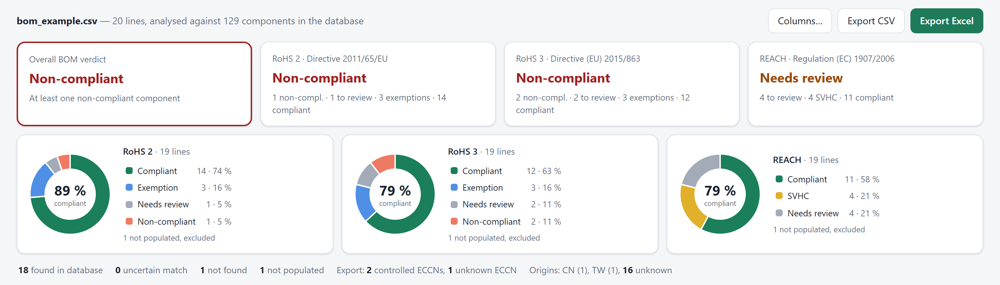
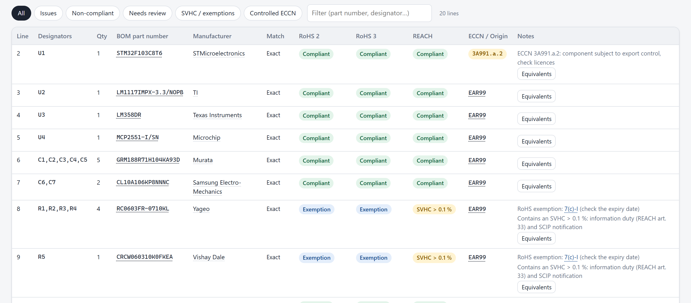
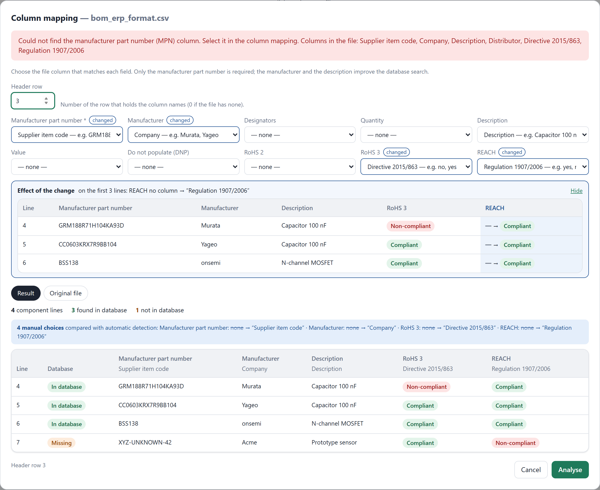
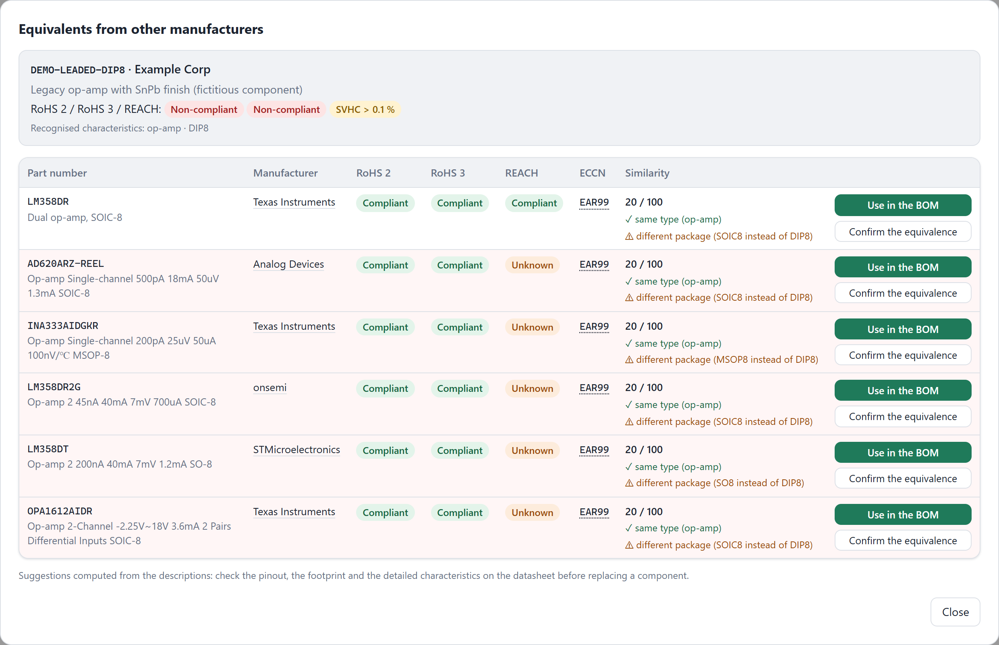
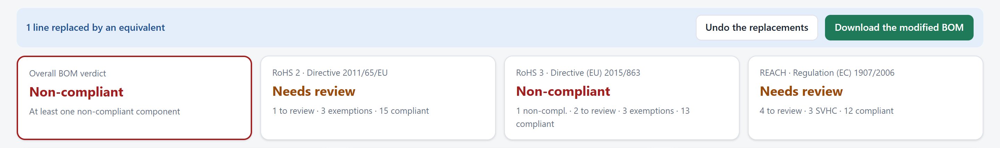
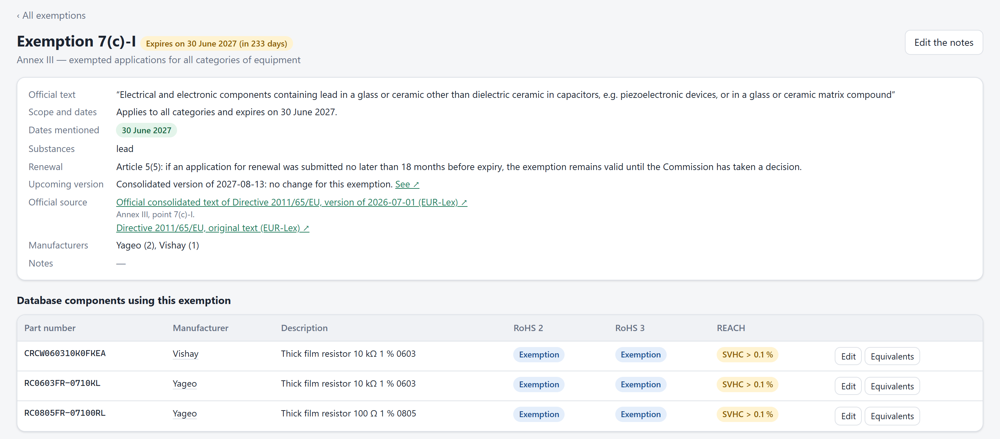
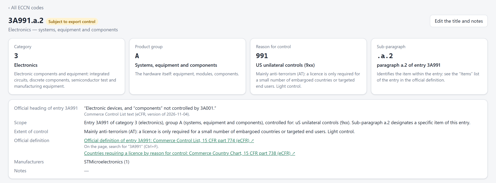
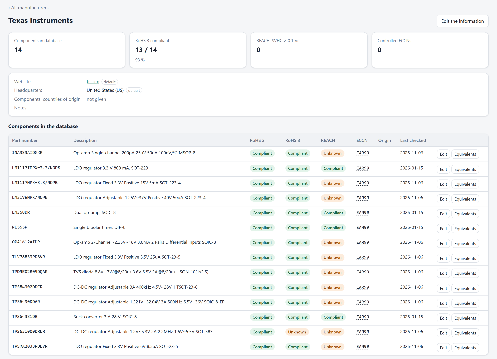
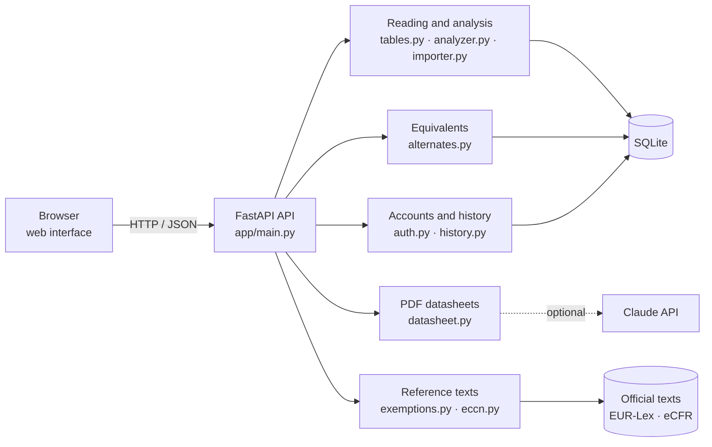

<div align="center">

# ♻️ RoHS · REACH · ECCN Checker

**Environmental compliance and export control analysis of an electronic bill of materials (BOM)**

[](https://github.com/ElliotGalaor/ElectronicEnvironmental/actions/workflows/ci.yml)
[](https://github.com/ElliotGalaor/ElectronicEnvironmental/actions/workflows/cd.yml)


[](https://github.com/ElliotGalaor/ElectronicEnvironmental/releases)



</div>

## At a glance

| | |
|---|---|
| **The problem** | Before an electronic board can be sold on the European market, every one of its components must be shown to comply with **RoHS** (hazardous substances: lead, mercury, cadmium, phthalates…) and **REACH** (substances of very high concern), and you need to know which ones are subject to **export control** (ECCN). Checking a bill of materials with dozens of part numbers by hand is slow and error-prone. |
| **The solution** | A web application that reads the bill of materials exported from the CAD tool, finds each component in a reference database and returns a verdict per regulation within seconds, with the problem components, the exemptions about to expire and **compliant equivalents from other manufacturers**. |
| **The sources** | Official texts: Directive 2011/65/EU on **EUR-Lex** (163 exemptions), the US Commerce Control List on the **eCFR** (622 ECCN entries). Component data collected from the distributor LCSC. |

## Features

### 📋 Bill of materials analysis
Upload a **CSV or Excel** file exported from any CAD tool, ERP or distributor: the header row and the columns (manufacturer part number, manufacturer, designators, quantity, do not populate, declared RoHS / REACH statuses…) are detected automatically, in English or French. Each line is matched against the database (exact, close, partial) and gets a **RoHS 2**, **RoHS 3** and **REACH** status. The result: an overall verdict, a pie chart per regulation and a downloadable **Excel** report.



### 🧩 Files in any format: column mapping
When a file does not look like any known format, for example an ERP export with a title block and custom headers, a dialog lets you **choose by hand which column matches each field**. You can also choose the header row, or say that the file has none. Before confirming, you can see:
- **the effect of each change** on the first lines (old value struck through → new value);
- **the result**, line by line: part number found or missing in the database, or, for a database import, what will be **created, changed or rejected**, simulated without writing anything;
- the **manual choices** compared with automatic detection.

The RoHS / REACH statuses found in the BOM are used. If the component is in the database, the database is authoritative: a disagreement turns the line into "needs review". If it is missing, the BOM status is used and marked "from the BOM".



### 🔁 Equivalents from other manufacturers and replacement in the BOM
For a non-compliant component, or one whose exemption is about to expire, the tool offers **similar components from other manufacturers** (same value, package, voltage…) with their compliance status, explains what matches and what differs, and lets you **substitute them in the BOM** in one click. The modified BOM can be downloaded with a record of the replacements. On a narrow screen (laptop, tablet, phone), each suggestion is shown as a card: the buttons always stay visible.





### ⏳ RoHS exemptions: official text and expiry dates
Each exemption in use (e.g. `7(c)-I`, lead in the glass of resistors) has its own page: **official text** extracted from EUR-Lex, scope, expiry dates, renewal rule and components concerned, so a replacement can be planned before the deadline.



### 🌐 Export control: ECCN codes
Each ECCN code is broken down (category, product group, reason for control), linked to its **official heading** and to its definition on the US government website.



### And also
- **Manufacturer pages**: website, headquarters, compliance statistics and list of components in the database.
- **PDF datasheet import**: extraction of the part number, manufacturer, RoHS/REACH statuses, ECCN and country of origin (rule-based, or with the **Claude API** if a key is configured), with the supporting excerpts.
- **User accounts**: history of the latest analysed BOMs, reopened against the up-to-date database.
- **Country of origin**, editable **component database**, CSV and Excel import/export (an update only changes the columns provided), documented REST API (`/docs`).

<details>
<summary>See the manufacturer page</summary>


</details>

## Tech stack

| Area | Technologies |
|---|---|
| Back end | **Python 3.12+**, **FastAPI**, Pydantic, SQLite (migrations at start-up) |
| Front end | HTML / CSS / **framework-free JavaScript**, hand-made SVG charts, light and dark themes, responsive down to mobile (*container queries*) |
| Documents | openpyxl (Excel), pypdf (datasheets), **Claude** API (optional extraction, structured outputs) |
| Security | Passwords hashed with **scrypt**, `HttpOnly` / `SameSite` cookie sessions, sign-in attempt throttling |
| Quality | **pytest** (72 tests), **ruff** (lint), automated screenshots (Playwright) |
| DevOps | **GitHub Actions**: CI (lint + tests on 3 Python versions) and CD (**Docker** image published to GHCR, smoke test, automatic release) |

## Architecture



## Way of working

The project follows a team workflow on GitHub:
- **issues** for every change or bug, with acceptance criteria ([backlog](https://github.com/ElliotGalaor/ElectronicEnvironmental/issues));
- **one branch and one pull request per change**, linked to its issue and reviewed before merging;
- mandatory **continuous integration** on every PR (lint + tests on Python 3.12, 3.13, 3.14);
- **continuous delivery**: every merge to `main` publishes a tested Docker image; every `v*` tag creates a release.

## Release history

Every change goes through a reviewed pull request, linked to its issue.

| Version | Pull request | Content |
|---|---|---|
| [**v1.0.0**](https://github.com/ElliotGalaor/ElectronicEnvironmental/releases/tag/v1.0.0) | [#10](https://github.com/ElliotGalaor/ElectronicEnvironmental/pull/10) | **Continuous integration**: `ruff` lint and tests on Python 3.12, 3.13 and 3.14 on every push and pull request |
| | [#11](https://github.com/ElliotGalaor/ElectronicEnvironmental/pull/11) | **Continuous delivery**: Docker image tested and published to GitHub Container Registry, automatic release on tag |
| | [#13](https://github.com/ElliotGalaor/ElectronicEnvironmental/pull/13) | Equivalents dialog readable on every screen: cards when space runs out |
| | [#14](https://github.com/ElliotGalaor/ElectronicEnvironmental/pull/14) | Presentation README with screenshots, separate technical guide |
| [**v1.1.0**](https://github.com/ElliotGalaor/ElectronicEnvironmental/releases/tag/v1.1.0) | [#16](https://github.com/ElliotGalaor/ElectronicEnvironmental/pull/16) | **Manual column mapping** for files in an unknown format: preview of the result and of each change, database import simulated before writing, RoHS / REACH statuses read from the BOM; fix: a database update no longer erases the fields missing from the file |
| *next* (v2.0.0) | this pull request | **Everything in English**: code, comments, interface, reports, documentation and official texts (English EUR-Lex version). Status values become `compliant`, `non_compliant`, `unknown`, `needs_review`…; databases created with v1 are converted automatically at start-up |

## Quick start

**With Docker** (no Python installation needed):

```bash
docker run -p 8000:8000 -v rohs-data:/data ghcr.io/elliotgalaor/electronicenvironmental
```

Then open http://localhost:8000. The database is initialised with 129 demo components. For a specific version, add its number to the image (`…/electronicenvironmental:1.1.0`).

To try it: drop [`examples/bom_example.csv`](examples/bom_example.csv) (CAD format, columns recognised automatically), then [`examples/bom_erp_format.csv`](examples/bom_erp_format.csv) (unknown format: the column mapping dialog opens).

**Locally**:

```bash
python -m venv .venv
.venv/Scripts/python -m pip install -r requirements-dev.txt   # Windows; .venv/bin/python on Linux/macOS
.venv/Scripts/python cli.py seed
.venv/Scripts/python -m uvicorn app.main:app --port 8000
.venv/Scripts/python -m pytest                                  # tests
```

## Roadmap

Next changes, tracked as issues:
- [ ] REACH status of the components from the distributor ([#4](https://github.com/ElliotGalaor/ElectronicEnvironmental/issues/4))
- [ ] Exemption expiry alert in the BOM analysis ([#5](https://github.com/ElliotGalaor/ElectronicEnvironmental/issues/5))
- [ ] Password reset ([#6](https://github.com/ElliotGalaor/ElectronicEnvironmental/issues/6))
- [ ] HTTPS deployment guide ([#7](https://github.com/ElliotGalaor/ElectronicEnvironmental/issues/7))
- [ ] Corpus of real datasheets for the extraction ([#8](https://github.com/ElliotGalaor/ElectronicEnvironmental/issues/8))
- [ ] Validation of KiCad, Altium and Eagle exports ([#9](https://github.com/ElliotGalaor/ElectronicEnvironmental/issues/9))

## Documentation

- **[Technical guide](docs/GUIDE.md)**: detailed behaviour, matching and compliance rules, REST API, environment variables, updating the official texts.
- Interactive API documentation: `http://localhost:8000/docs` once the application is running.

> ⚠️ The demo data is there to showcase the tool. A statement of compliance must rely on the manufacturers' declarations.

---

<div align="center">
Project by <a href="https://github.com/ElliotGalaor">ElliotGalaor</a>
</div>
