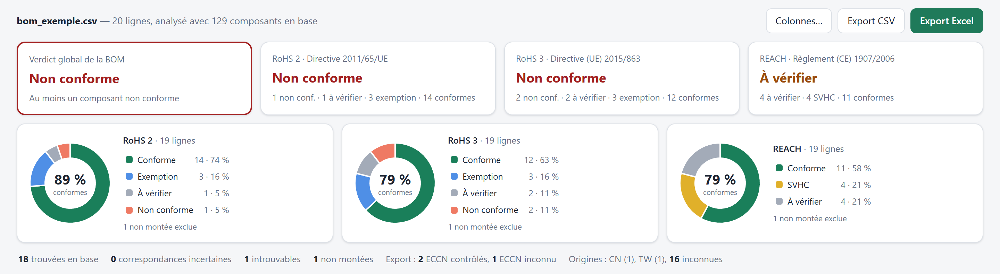
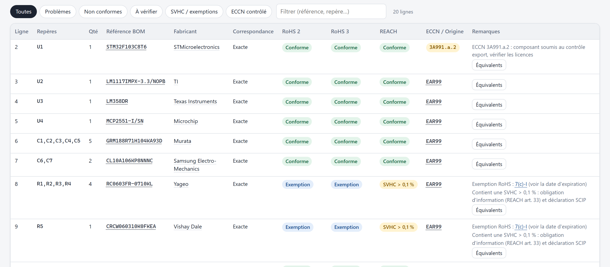
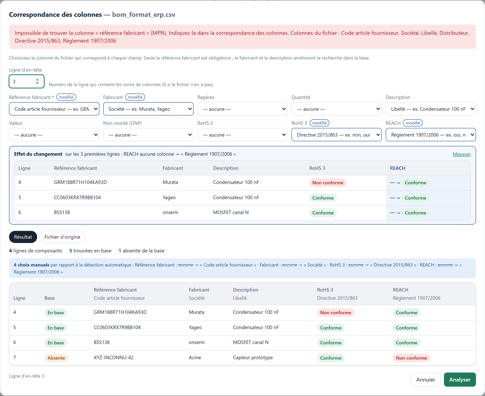
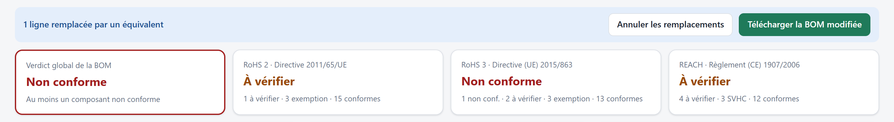
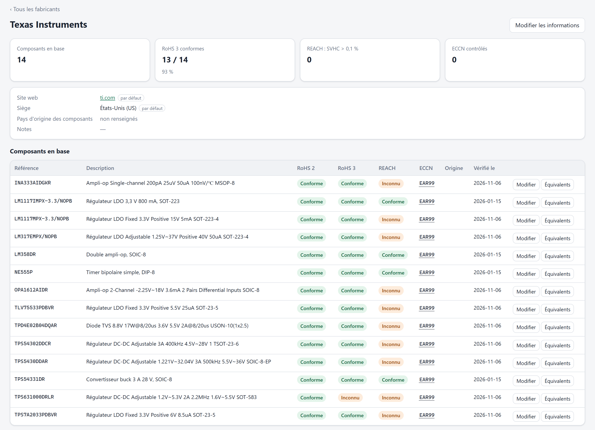
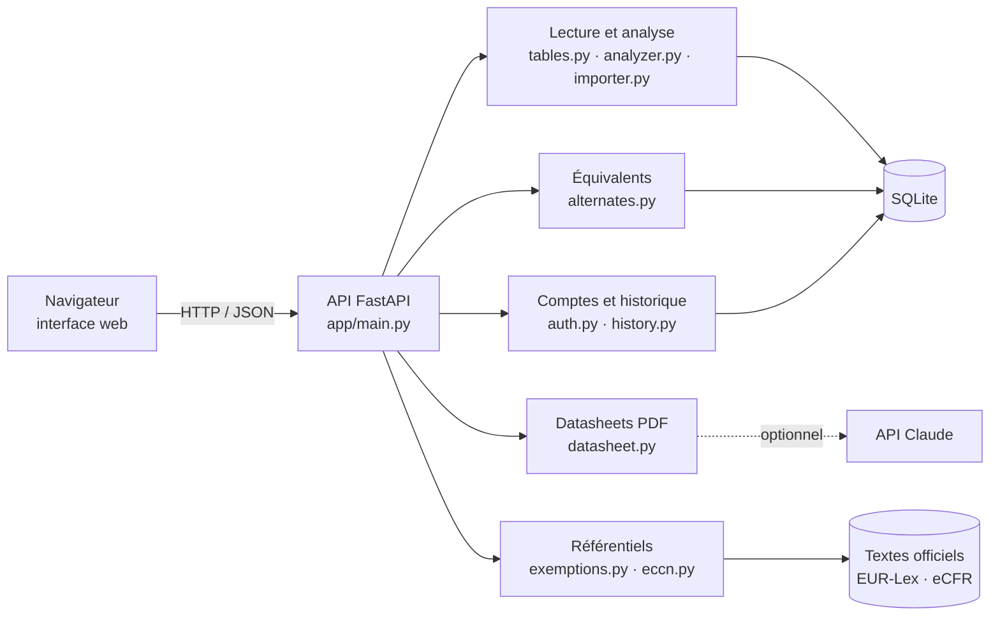

<div align="center">

# ♻️ Vérificateur RoHS · REACH · ECCN

**Analyse de conformité environnementale et de contrôle export d'une nomenclature électronique (BOM)**

[](https://github.com/ElliotGalaor/ElectronicEnvironmental/actions/workflows/ci.yml)
[](https://github.com/ElliotGalaor/ElectronicEnvironmental/actions/workflows/cd.yml)


[](https://github.com/ElliotGalaor/ElectronicEnvironmental/releases)



</div>

## En bref

| | |
|---|---|
| **Le problème** | Avant de mettre une carte électronique sur le marché européen, il faut prouver que chacun de ses composants respecte **RoHS** (substances dangereuses : plomb, mercure, cadmium, phtalates…) et **REACH** (substances extrêmement préoccupantes), et savoir lesquels sont soumis au **contrôle export** (ECCN). Vérifier une nomenclature de plusieurs dizaines de références à la main est long et source d'erreurs. |
| **La solution** | Une application web qui lit la nomenclature exportée de l'outil de CAO, retrouve chaque composant dans une base de référence et donne en quelques secondes un verdict par norme, avec les composants à problème, les exemptions qui vont expirer et des **équivalents conformes d'autres fabricants**. |
| **Les sources** | Textes officiels : directive 2011/65/UE sur **EUR-Lex** (161 exemptions), Commerce Control List américaine sur l'**eCFR** (622 entrées ECCN). Données composants relevées chez le distributeur LCSC. |

## Fonctionnalités

### 📋 Analyse d'une nomenclature
Dépôt d'un fichier **CSV ou Excel** exporté de n'importe quel outil de CAO, ERP ou distributeur : la ligne d'en-tête et les colonnes (référence fabricant, fabricant, repères, quantité, non monté, statuts RoHS / REACH déclarés…) sont détectées automatiquement, en français comme en anglais. Chaque ligne est rapprochée de la base (exacte, approchante, partielle) et reçoit un statut **RoHS 2**, **RoHS 3** et **REACH**. Résultat : un verdict global, un camembert par norme et un rapport **Excel** téléchargeable.



### 🧩 Fichiers de tout format : correspondance des colonnes
Quand un fichier ne ressemble à aucun format connu, par exemple un export d'ERP avec un cartouche et des en-têtes maison, une fenêtre permet d'**indiquer à la main quelle colonne correspond à chaque champ**. On peut aussi choisir la ligne d'en-tête, ou indiquer que le fichier n'en a pas. Avant de valider, on voit :
- **l'effet de chaque changement** sur les premières lignes (ancienne valeur barrée → nouvelle) ;
- **le résultat**, ligne par ligne : référence trouvée ou absente de la base, ou, pour l'import en base, ce qui sera **créé, modifié ou refusé**, simulé sans rien écrire ;
- les **choix manuels** par rapport à la détection automatique.

Les statuts RoHS / REACH présents dans la BOM sont utilisés. Si le composant est en base, c'est la base qui fait foi : un désaccord passe la ligne en « à vérifier ». S'il est absent, le statut de la BOM est repris et marqué « selon la BOM ».



### 🔁 Équivalents d'autres fabricants et remplacement dans la BOM
Pour un composant non conforme ou bientôt sans exemption, l'outil propose des **composants similaires d'autres fabricants** (même valeur, boîtier, tension…) avec leur statut de conformité, explique ce qui correspond et ce qui diffère, et permet de **les substituer dans la BOM** en un clic. La BOM modifiée se télécharge avec la trace des remplacements. Sur un écran étroit (portable, tablette, mobile), chaque suggestion s'affiche en carte : les boutons restent toujours visibles.




### ⏳ Exemptions RoHS : texte officiel et dates d'expiration
Chaque exemption utilisée (ex. `7(c)-I`, plomb dans le verre des résistances) a sa fiche : **texte officiel en français** extrait d'EUR-Lex, champ d'application, dates d'expiration, règle de renouvellement et composants concernés, pour anticiper un remplacement avant l'échéance.


### 🌐 Contrôle export : codes ECCN
Chaque code ECCN est décomposé (catégorie, groupe de produits, motif de contrôle), relié à son **intitulé officiel** et à sa définition sur le site du gouvernement américain.


### Et aussi
- **Fiches fabricants** : site web, siège, statistiques de conformité et liste des composants en base.
- **Import de datasheet PDF** : extraction de la référence, du fabricant, des statuts RoHS/REACH, de l'ECCN et du pays d'origine (par règles, ou par l'**API Claude** si une clé est configurée), avec les extraits justificatifs.
- **Comptes utilisateurs** : historique des dernières BOM analysées, rouvertes avec la base à jour.
- **Pays d'origine**, **base de composants** éditable, import/export CSV et Excel (une mise à jour ne modifie que les colonnes fournies), API REST documentée (`/docs`).

<details>
<summary>Voir la fiche fabricant</summary>


</details>

## Stack technique

| Domaine | Technologies |
|---|---|
| Back-end | **Python 3.12+**, **FastAPI**, Pydantic, SQLite (migrations au démarrage) |
| Front-end | HTML / CSS / **JavaScript sans framework**, graphiques SVG faits main, thème clair et sombre, affichage adaptatif jusqu'au mobile (*container queries*) |
| Documents | openpyxl (Excel), pypdf (datasheets), API **Claude** (extraction optionnelle, sorties structurées) |
| Sécurité | Mots de passe hachés **scrypt**, sessions par cookie `HttpOnly` / `SameSite`, limitation des tentatives de connexion |
| Qualité | **pytest** (70 tests), **ruff** (lint), captures d'écran automatisées (Playwright) |
| DevOps | **GitHub Actions** : CI (lint + tests sur 3 versions de Python) et CD (image **Docker** publiée sur GHCR, test de fumée, release automatique) |

## Architecture



## Méthode de travail

Le projet suit un fonctionnement d'équipe sur GitHub :
- **issues** pour chaque évolution ou bug, avec critères d'acceptation ([backlog](https://github.com/ElliotGalaor/ElectronicEnvironmental/issues)) ;
- **une branche et une pull request par changement**, liée à son issue et relue avant fusion ;
- **intégration continue** obligatoire sur chaque PR (lint + tests sur Python 3.12, 3.13, 3.14) ;
- **livraison continue** : chaque fusion sur `main` publie une image Docker testée ; chaque tag `v*` crée une release.

## Historique des versions

Chaque évolution passe par une pull request relue, liée à son issue.

| Version | Pull request | Contenu |
|---|---|---|
| [**v1.0.0**](https://github.com/ElliotGalaor/ElectronicEnvironmental/releases/tag/v1.0.0) | [#10](https://github.com/ElliotGalaor/ElectronicEnvironmental/pull/10) | **Intégration continue** : lint `ruff` et tests sur Python 3.12, 3.13 et 3.14 à chaque push et pull request |
| | [#11](https://github.com/ElliotGalaor/ElectronicEnvironmental/pull/11) | **Livraison continue** : image Docker testée et publiée sur GitHub Container Registry, release automatique sur tag |
| | [#13](https://github.com/ElliotGalaor/ElectronicEnvironmental/pull/13) | Fenêtre des équivalents lisible sur tous les écrans : affichage en cartes quand la place manque |
| | [#14](https://github.com/ElliotGalaor/ElectronicEnvironmental/pull/14) | README de présentation avec captures d'écran, guide technique séparé |
| *prochaine* | [#16](https://github.com/ElliotGalaor/ElectronicEnvironmental/pull/16) | **Correspondance manuelle des colonnes** pour les fichiers de format inconnu : aperçu du résultat et de chaque changement, import en base simulé avant écriture, statuts RoHS / REACH lus dans la BOM ; correction : une mise à jour en base n'efface plus les champs absents du fichier |

## Démarrage rapide

**Avec Docker** (aucune installation de Python nécessaire) :

```bash
docker run -p 8000:8000 -v rohs-data:/data ghcr.io/elliotgalaor/electronicenvironmental
```

Puis ouvrir http://localhost:8000. La base est initialisée avec 129 composants de démonstration. Pour une version précise, ajouter son numéro à l'image (`…/electronicenvironmental:1.0.0`).

Pour essayer : déposer [`exemples/bom_exemple.csv`](exemples/bom_exemple.csv) (format CAO, colonnes reconnues automatiquement) puis [`exemples/bom_format_erp.csv`](exemples/bom_format_erp.csv) (format inconnu : la fenêtre de correspondance s'ouvre).

**En local** :

```bash
python -m venv .venv
.venv/Scripts/python -m pip install -r requirements-dev.txt   # Windows ; .venv/bin/python sous Linux/macOS
.venv/Scripts/python cli.py seed
.venv/Scripts/python -m uvicorn app.main:app --port 8000
.venv/Scripts/python -m pytest                                  # tests
```

## Feuille de route

Prochaines évolutions suivies en issues :
- [ ] Statut REACH des composants issus du distributeur ([#4](https://github.com/ElliotGalaor/ElectronicEnvironmental/issues/4))
- [ ] Alerte d'expiration d'exemption dans l'analyse de BOM ([#5](https://github.com/ElliotGalaor/ElectronicEnvironmental/issues/5))
- [ ] Réinitialisation du mot de passe ([#6](https://github.com/ElliotGalaor/ElectronicEnvironmental/issues/6))
- [ ] Guide de déploiement HTTPS ([#7](https://github.com/ElliotGalaor/ElectronicEnvironmental/issues/7))
- [ ] Corpus de vraies datasheets pour l'extraction ([#8](https://github.com/ElliotGalaor/ElectronicEnvironmental/issues/8))
- [ ] Validation des exports KiCad, Altium, Eagle ([#9](https://github.com/ElliotGalaor/ElectronicEnvironmental/issues/9))

## Documentation

- **[Guide technique](docs/GUIDE.md)** : fonctionnement détaillé, règles de rapprochement et de conformité, API REST, variables d'environnement, mise à jour des textes officiels.
- Documentation interactive de l'API : `http://localhost:8000/docs` une fois l'application lancée.

> ⚠️ Les données de démonstration servent à présenter l'outil. Une attestation de conformité doit s'appuyer sur les déclarations des fabricants.

---

<div align="center">
Projet réalisé par <a href="https://github.com/ElliotGalaor">ElliotGalaor</a>
</div>
