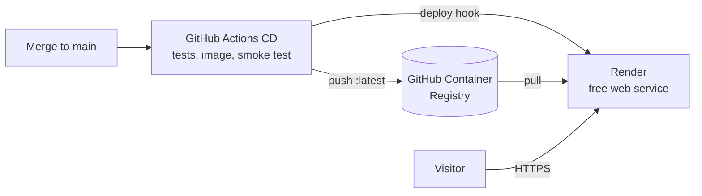

# Deploying on Render (free)

This guide puts the RoHS / REACH Checker online over **HTTPS**, as a free web service on
[Render](https://render.com). Render runs the Docker image published by the CD workflow and provides the
`https://….onrender.com` address and its certificate. Everything is described in one file at the root of the
repository, [`render.yaml`](../render.yaml) (a Render *Blueprint*).



## What the free plan gives

| | Render free web service |
|---|---|
| Address | `https://<name>.onrender.com`, HTTPS certificate included, HTTP redirected to HTTPS |
| Resources | 0.1 CPU, 512 MB of memory, 750 instance hours per month per workspace (one service running all month) |
| Sleep | after **15 minutes without visits**; the next visit wakes it up in about a minute |
| Data | **not kept**: the database starts again from the 129 demo components after every deploy, restart or wake-up. Accounts, BOM history and database edits are lost |
| Card | not required |

It suits a **public demo**: BOM analysis, exemptions, ECCN codes and the demo database all work. To keep the
data, see [Keeping the data](#keeping-the-data).

## 1. Create the service

Use the **Deploy to Render** button of the README, or open
`https://render.com/deploy?repo=https://github.com/ElliotGalaor/ElectronicEnvironmental`.
The same thing from the dashboard: **New → Blueprint**, pick the repository, branch `main`.

Sign in to Render (a GitHub account works). Render reads `render.yaml` and shows one service,
`rohs-checker` (free plan, Frankfurt region): name the Blueprint, then click **Deploy Blueprint**.
The first deploy takes a few minutes. The address is shown at the top of the service page; if the name is
already taken, Render adds a suffix to it.

## 2. Get the admin token

Render generated a random **admin token** at creation. To read it: service page → **Environment** →
`RRC_ADMIN_TOKEN` → show / copy.

It is required to edit the component database (Database tab, field "Admin token"). Browsing and BOM
analysis stay open to everyone.

## 3. Automatic updates

Render does not redeploy an image-based service by itself when a new image is published. The CD workflow
does it, through the service's **deploy hook**:

1. In Render: service page → **Settings** → **Deploy Hook** → copy the URL. Keep it private: anyone who has
   it can trigger a deploy.
2. In GitHub: repository **Settings** → **Secrets and variables** → **Actions** → **New repository secret**,
   name `RENDER_DEPLOY_HOOK_URL`, value the URL.

From then on, every merge to `main` runs the tests, publishes the image, then the **Deploy to Render** job
calls the hook and Render pulls the new image. Without the secret, the job does nothing (its log says so);
a deploy can still be started by hand: **Manual Deploy → Deploy latest reference**.

To stay on a given version instead of following `main`, replace `:latest` with the version number
(`:2.0.0`) in `image.url` of `render.yaml`. Render applies the Blueprint changes merged to `main`.

## Optional: AI datasheet extraction

Service page → **Environment** → add `ANTHROPIC_API_KEY` with your Claude API key, then save (Render
redeploys). The variables added in the dashboard are kept when the Blueprint is synchronised.

## Keeping the data

A free service cannot keep files. To keep accounts, history and database edits:

- **Paid instance with a persistent disk**: in `render.yaml`, set `plan: starter` and add the disk below,
  mounted where the database lives (`/data`, see `RRC_DB_PATH`). It also removes the sleep. Billed monthly,
  see [render.com/pricing](https://render.com/pricing). Not tested in this project.

  ```yaml
      disk:
        name: data
        mountPath: /data
        sizeGB: 1
  ```

- **Hosted database**: would replace SQLite and requires code changes.

## Limits

- Free services count against the workspace's included outbound bandwidth and build minutes. If the
  bandwidth runs out and no payment method is on file, Render suspends the free services until the end of
  the month. Pages and BOM files are small: a demo stays far below.
- Render may restart a free service at any time, which resets the data.
- The region (Frankfurt, the closest to Europe) cannot be changed after creation.

## Troubleshooting

- **The first page takes about a minute**: the service was asleep. Normal on the free plan.
- **Edits or accounts disappeared**: the service was restarted or woke up (see the table above).
- **Deploy fails with "No open ports detected"**: the `PORT` variable must be `8000` (set by `render.yaml`).
- **"Admin token required (X-Admin-Token header)"** when editing: enter the token from the Environment page
  in the Database tab.
- **Sign-in does not persist**: `FORWARDED_ALLOW_IPS` must be `*` (set by `render.yaml`); without it, the
  application does not see that the visit is over HTTPS.
- **The "Deploy to Render" job fails with HTTP 404**: the hook URL was regenerated or mistyped; update the
  `RENDER_DEPLOY_HOOK_URL` secret.
