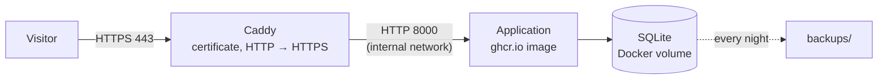

# Deploying on a free Google Cloud VM

This guide puts the RoHS / REACH Checker online over **HTTPS**, on the Google Cloud *Always Free* virtual
machine (e2-micro). The application runs from its published Docker image, behind
[Caddy](https://caddyserver.com/), which obtains and renews the Let's Encrypt certificate automatically.
The SQLite database (components, accounts, BOM history) lives on the VM's disk and survives restarts and updates.



Files used: [`deploy/`](../deploy) (`docker-compose.yml`, `Caddyfile`, `setup.sh`, `backup.sh`, `restore.sh`).

## What you need

- A Google account with **billing enabled** (a card is required even for the free tier).
- A **domain name** pointing to the VM: your own, or a free subdomain from [DuckDNS](https://www.duckdns.org)
  (e.g. `rohs-checker.duckdns.org`). Let's Encrypt only issues certificates for domain names, not bare IPs.

## 1. Create the VM

Open [Cloud Shell](https://shell.cloud.google.com) (terminal in the browser, `gcloud` already installed),
select your project, then run:

```bash
gcloud compute instances create rohs-checker \
  --zone=us-central1-a --machine-type=e2-micro \
  --image-family=debian-12 --image-project=debian-cloud \
  --boot-disk-size=30GB --boot-disk-type=pd-standard \
  --tags=http-server,https-server

gcloud compute firewall-rules create allow-web \
  --allow=tcp:80,tcp:443,udp:443 --target-tags=http-server,https-server
```

The free tier only covers this exact setup: **e2-micro**, in **us-west1, us-central1 or us-east1**, with a
**standard** disk (`pd-standard`, up to 30 GB). The console defaults to a "balanced" disk, which is billed.
If the firewall rule already exists, the second command fails harmlessly.

Keep the IP address fixed, so the domain keeps pointing to the VM after a stop/start:

```bash
IP=$(gcloud compute instances describe rohs-checker --zone=us-central1-a \
  --format='get(networkInterfaces[0].accessConfigs[0].natIP)')
gcloud compute addresses create rohs-checker-ip --region=us-central1 --addresses="$IP"
echo "$IP"
```

## 2. Point the domain to the VM

Give the domain an **A record** with the IP shown above. With DuckDNS: sign in, create the subdomain,
paste the IP in the *current ip* field and click *update ip*.

Check before going further (the answer must be the VM's IP):

```bash
getent hosts rohs-checker.duckdns.org
```

## 3. Install and start the application

Still in Cloud Shell, connect to the VM:

```bash
gcloud compute ssh rohs-checker --zone=us-central1-a
```

Then, on the VM:

```bash
sudo apt-get update && sudo apt-get install -y git
git clone https://github.com/ElliotGalaor/ElectronicEnvironmental.git
sudo sh ElectronicEnvironmental/deploy/setup.sh rohs-checker.duckdns.org
```

`setup.sh` adds a 1 GB swap file, installs Docker, copies the files to `/opt/rohs-checker`, creates the
settings file `.env` with a random **admin token**, starts the stack and schedules a nightly backup.
Write down the admin token it prints: it is required to edit the component database (Database tab, field
"Admin token"). Browsing and BOM analysis stay open to everyone.

Open `https://rohs-checker.duckdns.org`: the database starts with the 129 demo components.

## Day-to-day operations

All commands run on the VM, from `/opt/rohs-checker`:

| Task | Command |
|---|---|
| Status | `sudo docker compose ps` |
| Logs | `sudo docker compose logs -f app` (or `caddy`) |
| Update to the latest image | `sudo docker compose pull && sudo docker compose up -d` |
| Pin a version | set `APP_VERSION=2.0.0` in `.env`, then the update command |
| Show the admin token | `sudo grep RRC_ADMIN_TOKEN .env` |
| Enable AI datasheet extraction | set `ANTHROPIC_API_KEY=` in `.env`, then `sudo docker compose up -d` |
| Back up now | `sudo ./backup.sh` |
| Restore a backup | `sudo ./restore.sh backups/components-<date>.db` |

Backups run every night at 03:00 (server time, UTC) into `/opt/rohs-checker/backups`; the 14 most recent
are kept. They stay on the VM: to keep a copy elsewhere, download one from Cloud Shell:

```bash
gcloud compute scp rohs-checker:/opt/rohs-checker/backups/components-<date>.db . --zone=us-central1-a
```

Running `setup.sh` again (after a `git pull`) updates the files and keeps `.env` and the data.

## Costs and limits

- **Free**: one e2-micro VM, 30 GB of standard disk and 1 GB of outbound traffic per month (to most
  destinations), for as long as Google keeps the offer. Enough for a demo or a small team.
- **Possibly billed: the public IPv4 address.** Google's free tier page says it is not charged, but several
  2026 guides report about $0.005 per hour (around $3.65 per month). Check the first invoice.
- **Set a budget alert** (Billing → Budgets & alerts, e.g. $1) to be warned of any charge.
- The VM has 1 GB of memory: fine for this application, not for heavy traffic. From Europe, the US regions
  add about 100 ms of latency.

## Troubleshooting

- **No certificate / browser warning**: the domain must point to the VM and ports 80 and 443 must be open.
  See `sudo docker compose logs caddy`; Caddy retries on its own once the DNS is right.
- **"Admin token required (X-Admin-Token header)"** when editing: enter the token from `.env` in the
  Database tab.
- **Sign-in does not persist**: the site must be opened over `https://` (the session cookie is marked
  `Secure` behind Caddy).
