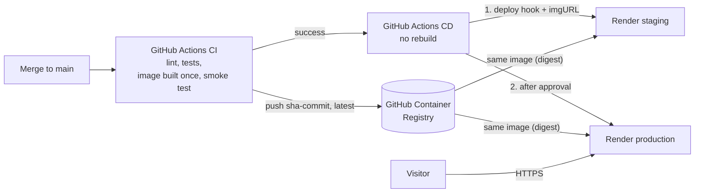

# Deploying on Render (free)

This guide puts the RoHS / REACH Checker online over **HTTPS**, as a free web service on
[Render](https://render.com). Render runs the Docker image built by the CI workflow and provides the
`https://….onrender.com` address and its certificate. Everything is described in one file at the root of the
repository, [`render.yaml`](../render.yaml) (a Render *Blueprint*).



## What the free plan gives

| | Render free web service |
|---|---|
| Address | `https://<name>.onrender.com`, HTTPS certificate included, HTTP redirected to HTTPS |
| Resources | 0.1 CPU, 512 MB of memory, 750 instance hours per month per workspace (one service running all month) |
| Sleep | after **15 minutes without visits**; the next visit wakes it up in about a minute |
| Data | **not kept**: the database starts again from the 129 demo components after every deploy, restart or wake-up. Accounts, BOM history and database edits are lost |
| Card | not required |

It suits a **public demo**: BOM analysis, exemptions, ECCN codes and the demo database all work. To keep the
data, see [Keeping the data](#keeping-the-data).

## 1. Create the service

Use the **Deploy to Render** button of the README, or open
`https://render.com/deploy?repo=https://github.com/ElliotGalaor/ElectronicEnvironmental`.
The same thing from the dashboard: **New → Blueprint**, pick the repository, branch `main`.

Sign in to Render (a GitHub account works). Render reads `render.yaml` and shows one service,
`rohs-checker` (free plan, Frankfurt region): name the Blueprint, then click **Deploy Blueprint**.
The first deploy takes a few minutes. The address is shown at the top of the service page; if the name is
already taken, Render adds a suffix to it.

## 2. Choose the administrator

Changes to the component database are reserved for the administrator and for the accounts it approves.
Browsing and BOM analysis stay open to everyone.

1. Service page → **Environment**: add `RRC_ADMIN_EMAIL` with your e-mail address, then save.
2. On the site, create an account with this address: it is the **administrator** account. It can change the
   database at once, with no daily limit, and is the only one that can delete components.

Until `RRC_ADMIN_EMAIL` is set, nobody can change the database.

Other users ask for edit access from the **Database** tab. You receive an e-mail with a link to approve or
refuse the request, and they are told the answer by e-mail. This needs the e-mail service (Brevo, see
[Optional: protect sign-ups](#optional-protect-sign-ups)). An approved account can add 20 new components per
24 hours (`RRC_DAILY_ADDITIONS` to change it); edits of existing components are not limited.

On the free plan, accounts are lost at every restart (see the table above): create the administrator account
again after a restart, and approved users have to ask again.

## 3. Automatic updates

Render does not redeploy an image-based service by itself when a new image is published. Two GitHub Actions
workflows do it, with one rule: **the image is built once, then promoted from one environment to the next**.

- **CI** ([`ci.yml`](../.github/workflows/ci.yml)), on every pull request, merge to `main` and `v*` tag: lint,
  tests on three Python versions, then the Docker image is built **once** and smoke-tested. On `main` and on
  tags, that same image is pushed to GitHub Container Registry as `sha-<commit>` (the first 7 characters of the
  commit), plus `latest` on `main` and the version number on tags, which also get a GitHub release. Pull
  requests build and test the image without publishing it.
- **CD** ([`cd.yml`](../.github/workflows/cd.yml)), after every successful CI run on `main`: no rebuild, no
  tests. It looks up the digest of the `sha-<commit>` image of that run, deploys it to **staging**, then, once
  a reviewer approves, deploys the same digest to **production**. Each environment is a Render service, called
  through its **deploy hook** with an `imgURL` parameter: Render pulls exactly that image instead of the tag in
  its settings.

| GitHub environment | Render service | Deployed |
|---|---|---|
| `staging` | `rohs-checker-staging` | automatically, after every CI run that passes on `main` |
| `production` | `rohs-checker` | after approval, with the image staging received |

### Set up the environments

Once, preferably before the first merge that uses this pipeline:

1. **Staging service on Render**: **New → Web Service → Existing Image**, image URL
   `ghcr.io/elliotgalaor/electronicenvironmental:latest` (the same repository as production: Render only
   deploys an `imgURL` from the service's own image repository). Name `rohs-checker-staging`, region
   Frankfurt, instance type **Free**. Under **Environment Variables**, add `PORT` = `8000` and
   `FORWARDED_ALLOW_IPS` = `*`; under **Advanced**, set the health check path to `/api/stats`. The two free
   services share the workspace's 750 instance hours a month, but hours only count while a service is awake:
   a staging service that sleeps between checks uses few of them.
2. **Deploy hooks**: for each service, Render → service page → **Settings** → **Deploy Hook** → copy the URL.
   Keep them private: anyone who has one can trigger a deploy.
3. **`staging` environment**: GitHub repository → **Settings** → **Environments** → **New environment**, name
   `staging`. Under **Environment secrets**, add `RENDER_DEPLOY_HOOK_URL` with the staging hook URL.
4. **`production` environment**: the same, name `production`, secret `RENDER_DEPLOY_HOOK_URL` with the
   production hook URL. Then protect it:
   - **Required reviewers**: tick it and add yourself (and any other reviewer), then **Save protection
     rules**. Leave **Prevent self-review** unticked if you are the only reviewer, otherwise nobody can approve
     your own merges.
   - **Deployment branches and tags**: choose **Selected branches and tags** and add the `main` branch, so a
     workflow changed on another branch cannot use the production hook.
5. **Remove the repository secret** `RENDER_DEPLOY_HOOK_URL` if it exists (**Settings** → **Secrets and
   variables** → **Actions**). When an environment has no secret of that name, its jobs fall back to the
   repository secret: staging would deploy the production service.

Without its secret, an environment's deploy job does nothing, and its log says so. Required reviewers are
available on every GitHub plan for public repositories.

### Approve a production deploy

After a merge, the CD run deploys staging, then waits: the run page (**Actions** → **CD**) shows **Review
deployments**, and GitHub notifies the reviewers. Check the staging site, then tick `production` →
**Approve and deploy**, or **Reject**. When a newer run reaches production while an older one is still
waiting, the older one is cancelled: only the newest image waits for approval.

### Redeploy or roll back

**Actions** → **CD** → **Run workflow**, then enter an image tag: `sha-<commit>` for a commit of `main` (its
first 7 characters, for example `sha-6ca3777`), or a version number (`2.0.0`). The image goes through the same
steps: staging, then production after approval. The published tags are listed on the
[package page](https://github.com/ElliotGalaor/ElectronicEnvironmental/pkgs/container/electronicenvironmental).

The tag in `image.url` of `render.yaml` (`:latest`) is only used when Render deploys by itself: **Manual
Deploy → Deploy latest reference**, or a change to `render.yaml`. `latest` is the newest image of `main`,
which may not be approved yet: deploy production through the CD workflow instead.

## Optional: AI datasheet extraction

Service page → **Environment** → add `ANTHROPIC_API_KEY` with your Claude API key, then save (Render
redeploys). The variables added in the dashboard are kept when the Blueprint is synchronised.

## Optional: protect sign-ups

Anyone can create an account on a public site. Two protections limit this, and each one can be used without
the other (behaviour in the [technical guide](GUIDE.md#limiting-sign-ups)). The e-mail service also sends the
edit access requests to the administrator.

**E-mail confirmation with Brevo** (free plan: 300 e-mails per day). Render's free plan blocks outgoing SMTP,
so the application sends through Brevo's HTTPS API.

1. Create a free account on [brevo.com](https://www.brevo.com).
2. Add the address the e-mails will come from in the [senders](https://account.brevo.com/senders), then
   click the link Brevo sends to it: Brevo only sends from verified addresses.
3. Create an API key on the [API keys page](https://app.brevo.com/settings/keys/api) (**Generate a new API
   key**) and copy it: it is shown only once.
4. In Render, service page → **Environment**: add `RRC_BREVO_API_KEY` (the key) and `RRC_MAIL_FROM` (the
   verified address), then save.

With a free address as sender (free.fr, gmail.com…), Brevo shows one of its own addresses instead, to meet
Gmail's and Yahoo's sender rules: the e-mails arrive, but land in spam more often. A domain name of your own,
authenticated in Brevo, avoids this.

**Captcha with Cloudflare Turnstile** (free).

1. Create a free account on [Cloudflare](https://dash.cloudflare.com/sign-up), then open **Turnstile** →
   **Add widget**.
2. Name the widget, add the service's hostname (for example `rohs-checker.onrender.com`), keep the
   **Managed** mode and create it.
3. In Render, **Environment**: add `RRC_TURNSTILE_SITE_KEY` (site key) and `RRC_TURNSTILE_SECRET_KEY`
   (secret key), then save.

Render redeploys after each save, and these variables are kept when the Blueprint is synchronised. The
"Create an account" tab then shows the captcha, and new accounts wait for the e-mail confirmation. On the free
plan, a sign-up waiting for confirmation is lost if the service goes to sleep before the link is opened.

## Keeping the data

A free service cannot keep files. To keep accounts, history and database edits:

- **Paid instance with a persistent disk**: in `render.yaml`, set `plan: starter` and add the disk below,
  mounted where the database lives (`/data`, see `RRC_DB_PATH`). It also removes the sleep. Billed monthly,
  see [render.com/pricing](https://render.com/pricing). Not tested in this project.

  ```yaml
      disk:
        name: data
        mountPath: /data
        sizeGB: 1
  ```

- **Hosted database**: would replace SQLite and requires code changes.

## Limits

- Free services count against the workspace's included outbound bandwidth and build minutes. If the
  bandwidth runs out and no payment method is on file, Render suspends the free services until the end of
  the month. Pages and BOM files are small: a demo stays far below.
- Render may restart a free service at any time, which resets the data.
- The region (Frankfurt, the closest to Europe) cannot be changed after creation.

## Troubleshooting

- **The first page takes about a minute**: the service was asleep. Normal on the free plan.
- **Edits or accounts disappeared**: the service was restarted or woke up (see the table above).
- **Deploy fails with "No open ports detected"**: the `PORT` variable must be `8000` (set by `render.yaml`).
- **"Your account cannot change the database yet"**: request edit access in the Database tab, or sign in with
  the address set in `RRC_ADMIN_EMAIL`.
- **"Edit access requests are not set up on this server"**: set `RRC_ADMIN_EMAIL` and the Brevo variables.
- **Sign-in does not persist**: `FORWARDED_ALLOW_IPS` must be `*` (set by `render.yaml`); without it, the
  application does not see that the visit is over HTTPS.
- **"The confirmation e-mail could not be sent"**: check `RRC_BREVO_API_KEY`, and that `RRC_MAIL_FROM` is
  a verified sender in Brevo. The service logs (**Logs**) show Brevo's answer.
- **"Captcha check failed" for everyone**: the site's hostname must be listed in the Turnstile widget, and
  both keys must come from that widget.
- **"Deploy to production" stays "Waiting"**: it waits for a reviewer, see
  [Approve a production deploy](#approve-a-production-deploy).
- **"Image to deploy" fails**: the tag is not in the registry (a typo in a manual run, or a CI run that did
  not push its image).
- **A deploy job fails with HTTP 404**: the hook URL was regenerated or mistyped; update the
  `RENDER_DEPLOY_HOOK_URL` secret of that environment.
- **A deploy job fails with HTTP 400**: Render refused the `imgURL`. The service's image in Render must be
  `ghcr.io/elliotgalaor/electronicenvironmental` (with any tag).
